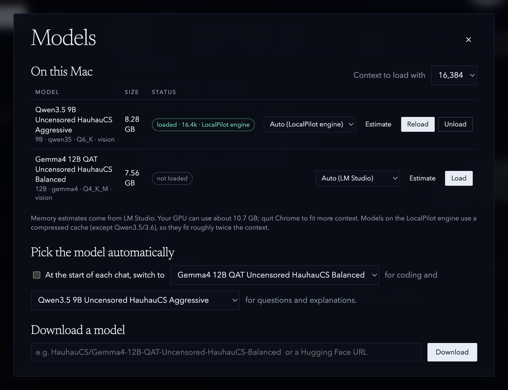
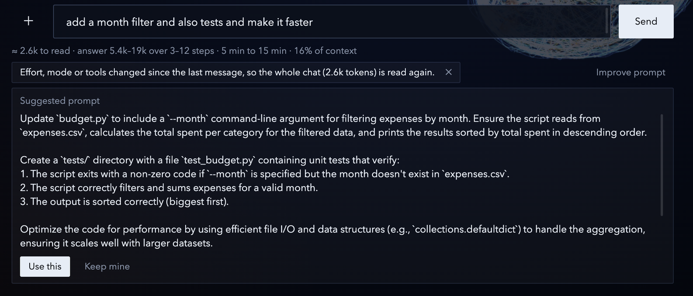
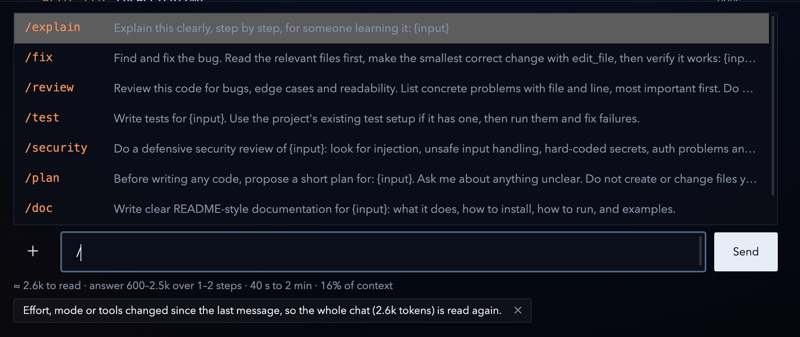

# LocalPilot

A desktop chat and coding agent for local models on macOS (Apple Silicon). It talks to
[LM Studio](https://lmstudio.ai) and to its own patched build of [llama.cpp](https://github.com/ggml-org/llama.cpp),
and can create and edit files, run commands (with your approval), search the web, read images, and ask you
clarifying questions.


*Qwen3.5 9B on the LocalPilot engine, Auto mode: it writes `budget.py` and a sample CSV, asks before running the
command, then answers. Recorded on a 16 GB M-series Mac; the waiting parts are sped up.*

## Features

- **Modes:** Chat (no tools), Manual (approve every change), Auto (file changes automatic, commands need approval)
- **Effort:** Low (no thinking), Medium, High (more steps, verifies its work), Auto (starts without thinking and turns
  it on, same model, when a self-check fails, tools fail twice, or the task passes 6 steps)
- **Tools:** list/search/read/write/edit files, run commands, open files, web search and page fetch, ask the user
- **Safety:** all file access is confined to the workspace folder; every agent run can be undone; web fetches of
  addresses that didn't come from a search or your message need approval; private-network addresses are blocked
- **Self-check:** syntax-checks Python/JS/shell/Ruby/JSON and loads HTML pages offline to catch JavaScript errors
- **Context:** live context meter, token counters (in / out / thinking / cached), auto-compact at 80%
- **Before you send** (*Estimate* and *Tips* under Extras, each can be turned off): a line under the message box
  with the tokens to read (new vs cached), the answer size, the time and the share of context, with a breakdown on
  click. Counts are exact on the LocalPilot engine and calibrated elsewhere; answer sizes and speeds come from your
  own past runs. Tips flag a full context, effort or mode that doesn't fit the request, long pastes, vague or
  bundled requests and changes that make the whole chat be read again; *Improve prompt* has the model rewrite it
- **Connect** (sidebar): use models on other machines, or share this one
  - *Share this computer*: its loaded model, and/or memory for pooled models, with a limit; pauses for others
    while you use it. Shows a 6-digit pairing code
  - *On this network*: machines found with Bonjour (or added by address); pair once with the code, then they
    reconnect by themselves
  - *Remote groups*: through a relay you run (see [`relay/`](relay/README.md)); invite codes, approvals
  - Shared models appear in the model picker by network and group, plus *Best available* (picks a free machine,
    keeps a chat on the same one, moves on if it leaves). The status at the top says where a chat is running
  - *Pooled model*: split a model too big for this Mac across machines' memory (llama.cpp RPC), with a measured
    speed estimate before loading over the internet
  - *Background jobs* can run on another machine
  - Machines prove who they are with device keys (kept in the Keychain) and talk over end-to-end encrypted
    links; the relay can't read them. Design and limits: [`docs/NETWORK_PLAN.md`](docs/NETWORK_PLAN.md)
- **Project memory:** each project can keep a `LOCALPILOT.md` that is loaded into the chat (you're warned when it's
  too long to fit)
- **Memory layer** (*Memory & skills*): after 2 idle minutes with a model loaded, finished chats are summarized into a
  journal the model can search (`search_history`), and tidied-up `LOCALPILOT.md` notes are proposed as a diff you
  approve, edit or reject. Skills (instructions plus a worked example) are listed by one line in the prompt and loaded
  with `load_skill` only when needed; *Save as skill* under an answer drafts one from that run
- **Source check:** answers built from web pages get a second pass listing claims the pages don't support
- **Rated answers:** 👍 saves the conversation as a training example in `examples/` for a later LoRA fine-tune
- **Warm chats:** on the LocalPilot engine, a chat's processed prompt is saved to disk (`kvcache/`, 3 GB max) when
  another chat or background job takes the model, and restored when you return
- **Models:** load/unload/download, per-model engine choice, memory estimates, auto-pick a model per chat,
  side-by-side comparison
- **Saved prompts:** type `/` for built-ins (`/fix`, `/review`, `/security`, …) or add your own
- **Images:** attach, paste or drop images for vision models

## Requirements

- macOS on Apple Silicon, Node.js 18+
- LM Studio with its `lms` CLI (`~/.lmstudio/bin/lms`)
- Optional: a local llama.cpp build at `~/llama.cpp/build/bin/llama-server` (the "LocalPilot engine")

## Run and build

```bash
npm install
npm start                 # run in development
npm run package           # build dist/LocalPilot-darwin-arm64/LocalPilot.app
```

## Using LocalPilot

1. **Pick a workspace.** Click the folder at the bottom of the sidebar. The model can only read and write inside it.
2. **Pick a model.** Choose one in the **Model** menu at the top; it loads the first time you send. **Manage** lists
   what's on your Mac with its size and engine, loads or unloads models, sets the context size, and downloads new
   ones from Hugging Face. You can also have it pick a model per chat (one for coding, one for questions).

   

3. **Set effort and mode.** *Effort* is how hard it thinks; *Mode* is how much it may do without asking. Auto mode
   writes files on its own but shows every command with **Run** / **Deny** first, as in the recording above.
4. **Check the estimate before you send.** Under the message box you'll see how much it has to read, about how long
   the answer will be and take, and how much of the context it uses. Click the line for the breakdown. Tips flag
   things like a bundled request or settings changes that make it read the whole chat again.

   

   **Improve prompt** has the model rewrite a vague request into a specific one. Choose *Use this* or *Keep mine*.

   

5. **Reuse prompts.** Type `/` for saved prompts. Whatever you type after the name fills in `{input}`. Add your own
   under **Saved prompts**.

   

6. **Review what it did.** Each tool call shows its file or command, the output and the self-check result. **Undo**
   reverts every file the run changed. 👍 saves the chat as a training example, and **Save as skill** turns a good run
   into a reusable skill.
7. **Let it remember.** Under **Memory & skills**, finished chats are summarized into a journal the model can
   search, and changes to the project's `LOCALPILOT.md` are proposed as a diff you can edit, reject or accept.

   

## The LocalPilot engine (llama.cpp)

Models whose architecture matches Qwen3.5/3.6 run on a local llama.cpp build by default; any model can be switched
in **Manage**. Two fixes are needed on macOS 13 (Ventura):

1. **`engine/ventura-metal-fix.patch`**: `newBufferWithBytesNoCopy` returns nil for non-page-aligned memory on older
   macOS, which made `ggml_metal_get_tensor_async` abort (`GGML_ASSERT(buf_dst)`) for hybrid models such as
   Qwen3.5. The patch falls back to a synchronous copy through a temporary buffer. Apply it to llama.cpp and build:

   ```bash
   git -C ~/llama.cpp apply ~/projects/localpilot/engine/ventura-metal-fix.patch
   cmake -S ~/llama.cpp -B ~/llama.cpp/build -DCMAKE_BUILD_TYPE=Release && cmake --build ~/llama.cpp/build -j --target llama-server
   ```

2. **`engine/bf16_to_f16.py`**: Ventura has no Metal bfloat kernels, so BF16 vision projectors (`mmproj-*-BF16.gguf`)
   crash on the GPU. Convert them to F16 (uses llama.cpp's `gguf-py`; needs numpy):

   ```bash
   python3 engine/bf16_to_f16.py mmproj-…-BF16.gguf mmproj-…-F16.gguf
   ```

On the LocalPilot engine, non-Qwen models use a q8 KV cache (about twice the context), Gemma 4 uses an MTP draft
model from `~/models/mtp-gemma-4-12B-it.gguf` when present (~30% faster here), and vision projectors next to the
model file are loaded automatically.
