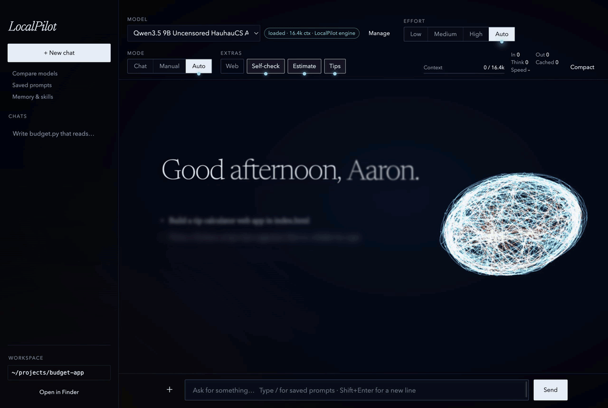
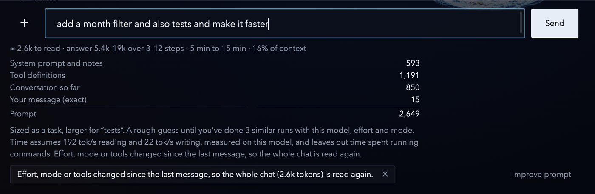
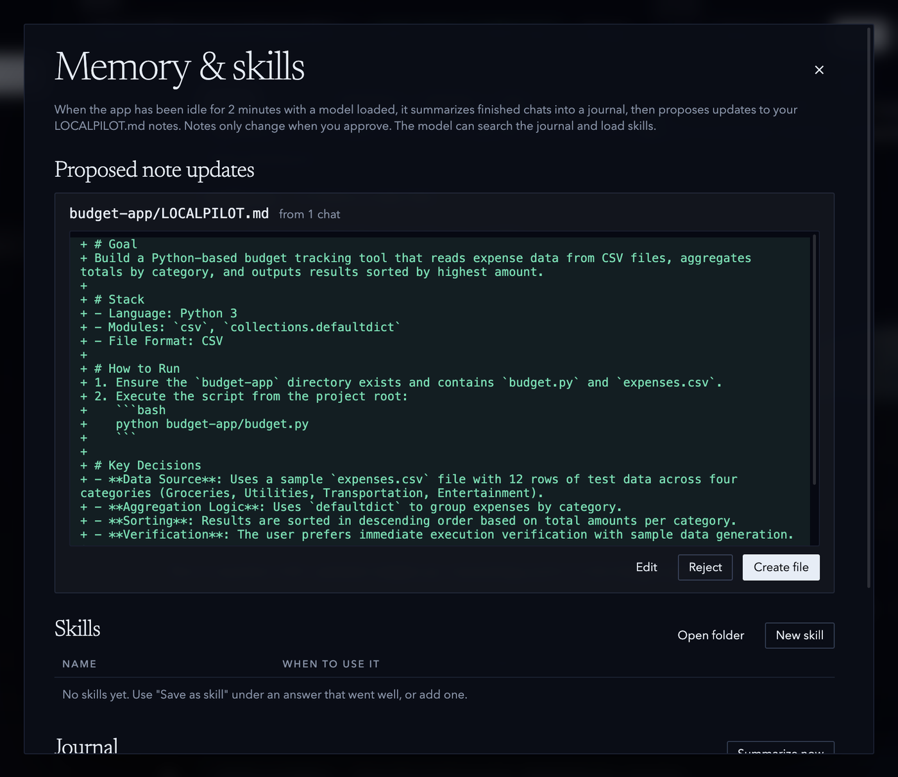

# LocalPilot

A desktop chat and coding agent for local models on macOS (Apple Silicon). It runs models through
[LM Studio](https://lmstudio.ai) or its own patched [llama.cpp](https://github.com/ggml-org/llama.cpp), and can edit
files, run commands (with your approval), search the web, read images and ask clarifying questions.



*Qwen3.5 9B in Auto mode on a 16 GB Mac (waiting sped up).*

## Quick start

Needs macOS on Apple Silicon, Node.js 18+ and LM Studio with its `lms` CLI.

```bash
npm install
npm start          # run in development
npm run package    # build dist/LocalPilot-darwin-arm64/LocalPilot.app
npm test           # agent loop, file tools and streaming, against a scripted model (~10 s)
```

## How to use it

1. **Pick a workspace** (bottom of the sidebar). The model can only touch files inside it.
2. **Pick a model** at the top. **Manage** loads, unloads and downloads models and sets the context size.
3. **Set effort and mode.** *Effort* is how hard it thinks (Low, Medium, High, or Auto, which turns thinking on when
   it struggles). *Mode* is how much it may do on its own: Chat (no tools), Manual (approve everything) or Auto
   (edits files and runs commands itself; still asks before
   ones that delete, use sudo, push, publish or upload).
4. **Check the estimate** under the message box: tokens to read, answer size, time and context share. Tips flag
   problems, and **Improve prompt** rewrites a vague request.

   

5. **Type `/`** for saved prompts such as `/fix`, `/review` and `/test`, or add your own.
6. **Review the run.** Every tool call shows its output and self-check result. **Undo** reverts the run's file
   changes, 👍 saves a training example, and **Save as skill** keeps a good approach.
7. **Let it remember.** Idle time is used to summarize chats into a searchable journal and to propose updates to
   each project's `LOCALPILOT.md` notes, which you approve.

   

## Features

- **Safety:** workspace-only file access, undo for every run, approval for commands and unknown web addresses,
  private-network addresses blocked
- **Self-check:** syntax-checks Python, JS, shell, Ruby and JSON, and loads HTML pages to catch JavaScript errors
- **Context:** live meter, token counters, auto-compact at 80%, and *warm chats* (a chat's cache is saved to disk
  when another chat takes the model)
- **Models:** per-model engine, memory estimates, auto-pick per chat, side-by-side comparison
- **Web:** search and page fetch, with a second pass that flags claims the pages don't support
- **Connect:** use models on other machines over the LAN or a relay ([`relay/`](relay/README.md)), pool memory to run
  a model too big for one Mac, with end-to-end encryption. See [`docs/NETWORK_PLAN.md`](docs/NETWORK_PLAN.md)
- **Images:** attach, paste or drop them for vision models

## The LocalPilot engine (llama.cpp)

Qwen3.5/3.6 models run on a local build at `~/llama.cpp/build/bin/llama-server` by default; any model can be
switched in **Manage**. On macOS 13 (Ventura) it needs two fixes:

```bash
# Metal crashes on non-page-aligned buffers for hybrid models like Qwen3.5; fall back to a copy
git -C ~/llama.cpp apply ~/projects/localpilot/engine/ventura-metal-fix.patch
cmake -S ~/llama.cpp -B ~/llama.cpp/build -DCMAKE_BUILD_TYPE=Release && cmake --build ~/llama.cpp/build -j --target llama-server

# No bfloat Metal kernels: convert BF16 vision projectors to F16 (needs numpy)
python3 engine/bf16_to_f16.py mmproj-…-BF16.gguf mmproj-…-F16.gguf
```

Non-Qwen models get a q8 KV cache (about twice the context). Gemma 4 uses an MTP draft model from
`~/models/mtp-gemma-4-12B-it.gguf` if present (~30% faster). Vision projectors next to a model load automatically.
